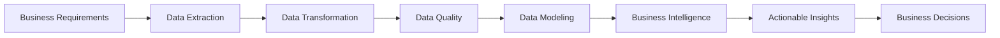

<!-- PROFILE HEADER -->

 

**Transforming complex data into actionable business insights through analytics, automation and modern data engineering.**

---

## About Me

I am a Data and Business Intelligence professional
with over 7 years of experience in data analytics,
business intelligence, financial reporting,
data modeling and reporting automation.

Currently, I work as a Data Analyst at MGO India,
supporting FP&A and business leadership through
enterprise dashboards, SQL-based analytical
solutions, financial reporting and data quality
initiatives.

Previously, I worked as a Lead BI Analyst at
Think & Learn, focusing on digital lending,
loan portfolio analytics, credit risk,
collections and repayment performance.

I am a Microsoft Certified Fabric Data Engineer
Associate (DP-700), with practical knowledge
of modern data engineering concepts,
Microsoft Fabric and scalable analytical solutions.

### Professional Focus

- Financial Planning & Analysis (FP&A)
- Business Intelligence & Data Analytics
- Microsoft Fabric & Data Engineering
- Advanced SQL & Database Development
- Financial and Operational Reporting
- ETL & Reporting Automation
- Data Modeling & Semantic Models
- Data Quality & Governance
- Digital Lending & Credit Risk Analytics
- Stakeholder Management & Business Insights

---

## Technical Skills

### Business Intelligence & Data Visualization

### Databases & Programming

### Data Engineering & Cloud Analytics

### Data Architecture & Governance

### Development & Collaboration

---

## Professional Experience

### Data Analyst | MGO India Pvt. Ltd.

**June 2024 – Present | Bengaluru, India**

- Partner with FP&A and business leadership to
  develop financial and operational analytics solutions.

- Develop interactive Power BI dashboards to monitor
  revenue, gross margin, realization, accounts receivable,
  work in progress and employee utilization.

- Develop and optimize complex SQL queries, stored
  procedures, views and analytical datasets.

- Automate recurring reporting and ETL workflows.

- Support month-end financial reporting and
  source-to-target reconciliation.

- Develop scalable data models and standardized
  DAX calculations.

- Implement data validation, quality checks and
  reporting governance practices.

- Collaborate with cross-functional stakeholders
  to translate business requirements into
  analytical solutions.

- Explore Microsoft Fabric for modern data
  engineering and analytical workloads.

### Lead BI Analyst | Think & Learn Pvt. Ltd.

**September 2019 – May 2024**

- Developed analytical solutions for digital
  lending and financial operations.

- Analyzed loan portfolios, credit risk,
  disbursements, repayment behavior and
  collection performance.

- Developed Power BI and Tableau dashboards
  for business and operational stakeholders.

- Designed SQL-based analytical datasets
  and automated recurring reports.

- Conducted customer segmentation,
  delinquency analysis and EMI bounce analysis.

- Supported bounce curing and collection
  optimization initiatives.

- Developed standardized KPI frameworks
  and business performance reports.

- Collaborated with business leadership,
  collections, risk and operational teams.

- Mentored team members and supported
  analytical best practices.

---

## Certifications

### Microsoft Certified: Fabric Data Engineer Associate

**Issued:** November 2026

Core competency areas:

- Microsoft Fabric analytics solutions
- Data ingestion and transformation
- Lakehouse and Warehouse architecture
- PySpark and Delta Lake
- Data pipelines and orchestration
- Incremental data processing
- Data security and governance
- Monitoring and performance optimization

<!-- Add your personal Microsoft credential verification link here. -->

---

## Featured Portfolio Projects

My portfolio demonstrates end-to-end analytical
solutions across financial analytics, workforce
management, digital lending, data engineering
and enterprise data governance.

### 01. FP&A Financial Performance Analytics

An end-to-end financial analytics solution designed
to monitor business performance, profitability,
financial trends and operational KPIs.

**Key Highlights**

- Revenue and gross margin analysis
- Financial performance dashboards
- Profitability and realization analysis
- Financial trend analysis
- SQL-based reporting automation
- Dimensional data modeling
- Financial reconciliation

**Technology Stack:** SQL Server, Power BI, DAX, Excel

---

### 02. Employee Utilization Optimization

A workforce analytics solution designed to monitor
employee productivity, utilization, chargeability
and resource capacity.

**Key Highlights**

- Employee utilization analysis
- Billable and non-billable hours
- Resource capacity planning
- Scheduled versus actual hours
- Employee productivity analysis
- Timesheet compliance
- Service line performance

**Technology Stack:** SQL Server, Power BI, DAX, ETL

---

### 03. Microsoft Fabric Data Platform

An enterprise data engineering portfolio solution
demonstrating modern analytical architecture
using Microsoft Fabric.

**Key Highlights**

- Medallion architecture
- Bronze, Silver and Gold layers
- OneLake and Lakehouse
- Delta Lake tables
- PySpark transformations
- Incremental data processing
- Power BI semantic models
- Data quality and governance

**Technology Stack:** Microsoft Fabric, PySpark,
OneLake, Delta Lake, SQL, Power BI

---

### 04. Loan Portfolio & Credit Risk Analytics

A digital lending analytics solution focused
on portfolio performance, customer risk
segmentation and delinquency monitoring.

**Key Highlights**

- Loan portfolio performance
- Disbursement and approval analysis
- Credit risk segmentation
- Days Past Due analysis
- Portfolio at Risk
- Vintage and cohort analysis
- Customer repayment behavior

**Technology Stack:** SQL, Python, Power BI, DAX

---

### 05. Fabric Pipeline Automation

A data engineering solution demonstrating
automated ingestion, transformation,
orchestration and pipeline monitoring.

**Key Highlights**

- Metadata-driven pipelines
- Incremental data loading
- Watermark-based processing
- Pipeline parameterization
- Notebook orchestration
- Error handling and audit logging
- Pipeline monitoring

**Technology Stack:** Microsoft Fabric,
Data Factory, PySpark, Dataflows Gen2, SQL

---

### 06. Accounts Receivable & WIP Analytics

A financial analytics solution focused on
working capital, outstanding receivables,
unbilled work and cash collection performance.

**Key Highlights**

- Accounts receivable analysis
- AR aging classification
- Work in progress monitoring
- Cash collection analysis
- Financial write-off analysis
- Client and engagement profitability
- Month-end financial reporting

**Technology Stack:** SQL Server, Power BI, DAX, Excel

---

### 07. Collections & Repayment Analytics

A fintech analytics solution designed to
monitor repayment behavior, collection
efficiency and bounce recovery performance.

**Key Highlights**

- EMI bounce analysis
- Bounce curing analysis
- Collection efficiency
- Customer repayment segmentation
- Delinquency and roll rate analysis
- Promise to Pay monitoring
- Collection performance reporting

**Technology Stack:** SQL, Python, Power BI, Tableau

---

### 08. Data Quality & Governance Framework

An enterprise data quality framework designed
to improve analytical data reliability,
reporting accuracy and governance.

**Key Highlights**

- Automated data validation
- Duplicate and null detection
- Source-to-target reconciliation
- Financial business rule validation
- Data quality monitoring
- Exception management
- Data lineage and documentation
- Access control and governance

**Technology Stack:** SQL Server, Python,
Microsoft Fabric, PySpark, Power BI

---

## Portfolio at a Glance

| Project | Business Domain | Key Technologies |
|---|---|---|
| [FP&A Financial Performance](https://github.com/JaydeepHanumante/fpa-financial-performance-analytics) | Financial Analytics | SQL, Power BI, DAX |
| [Employee Utilization](https://github.com/JaydeepHanumante/employee-utilization-analytics) | Workforce Analytics | SQL, Power BI, ETL |
| [Microsoft Fabric Data Platform](https://github.com/JaydeepHanumante/microsoft-fabric-data-platform) | Data Engineering | Fabric, PySpark, Delta Lake |
| [Loan Portfolio & Credit Risk](https://github.com/JaydeepHanumante/loan-portfolio-credit-risk-analytics) | Fintech | SQL, Python, Power BI |
| [Fabric Pipeline Automation](https://github.com/JaydeepHanumante/fabric-pipeline-automation) | Data Engineering | Fabric, Data Factory, PySpark |
| [Accounts Receivable & WIP](https://github.com/JaydeepHanumante/accounts-receivable-wip-analytics) | Financial Analytics | SQL, Power BI, DAX |
| [Collections & Repayment](https://github.com/JaydeepHanumante/collections-repayment-analytics) | Digital Lending | SQL, Power BI, Tableau |
| [Data Quality & Governance](https://github.com/JaydeepHanumante/data-quality-governance-framework) | Enterprise Data Management | SQL, Python, Fabric |

---

## End-to-End Analytics Expertise

---

## Core Competencies

| Competency | Expertise |
|---|---|
| SQL Development | Complex joins, CTEs, window functions, stored procedures and query optimization |
| Business Intelligence | Power BI, Tableau, executive dashboards and KPI development |
| Data Modeling | Star schema, dimensional modeling and semantic models |
| Data Engineering | ETL, Microsoft Fabric, Lakehouse and incremental processing |
| Financial Analytics | Revenue, gross margin, realization, AR, WIP and profitability |
| Operational Analytics | Utilization, chargeability, productivity and capacity planning |
| Digital Lending | Loan portfolios, credit risk, delinquency and collections |
| Data Quality | Validation, reconciliation, duplicate detection and exception analysis |
| Automation | SQL workflows, Python-assisted automation and reporting pipelines |
| Stakeholder Management | Requirements gathering, business collaboration and analytical communication |

---

## Business Domains

- Financial Planning & Analysis
- Professional Services Analytics
- Digital Lending & Fintech
- Credit Risk Analytics
- Collections & Repayment Analytics
- Workforce & Resource Management
- Enterprise Data Management
- Financial & Operational Reporting

---

## Currently Exploring

- Advanced Microsoft Fabric solutions
- Scalable data engineering architectures
- PySpark and distributed data processing
- Enterprise semantic model optimization
- AI-assisted analytics and automation
- Modern data governance practices

---

## GitHub Statistics

 

---

## GitHub Contribution Activity

---

## Portfolio Data & Confidentiality

The projects in this portfolio demonstrate
analytical approaches, technical implementations
and business problem-solving capabilities.

Public portfolio implementations use synthetic,
anonymized or appropriately authorized data
where applicable.

Confidential employer information, proprietary
business data and sensitive customer records
are not intended for public distribution.

---

## Let's Connect

<!-- Replace YOUR_LINKEDIN_USERNAME with your actual LinkedIn username. -->

 

**Open to opportunities in Data Analytics,
Business Intelligence, Analytics Engineering
and Data Engineering.**

 

 

*"Turning data into insights, insights into decisions,
and decisions into business value."*

